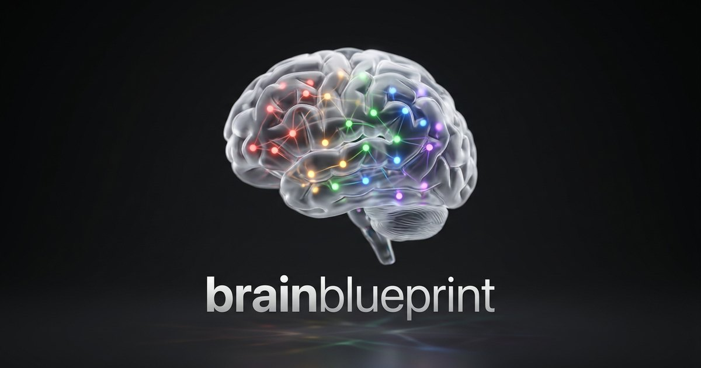
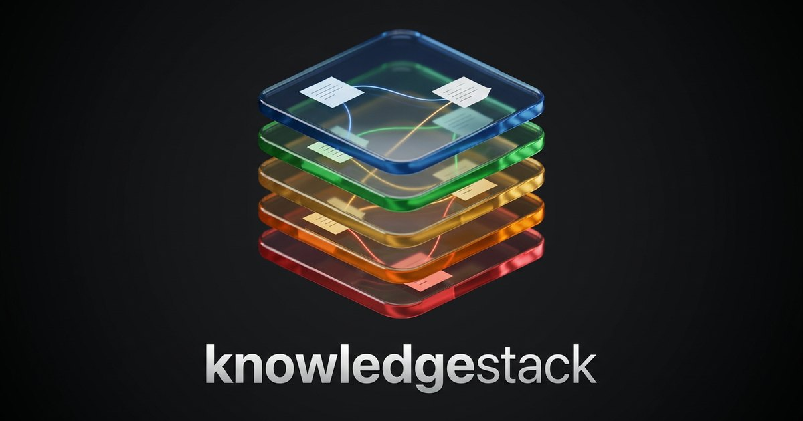

### I build agents that remember.

Production AI, long-term memory, and the plumbing in between.
Most of it runs where you can't see it. Some of it is below.

 

<table>
  <tr>
    <td width="50%" valign="top">
      
       <b><a href="https://github.com/2soum/brain-blueprint">brain-blueprint</a></b>
       Long-term memory for coding agents, done with files you can read. Blueprint + MCP server.
    </td>
    <td width="50%" valign="top">
      
       <b><a href="https://github.com/2soum/knowledge-stack">knowledge-stack</a></b>
       A knowledge base your agents can actually use. Method, vault template, linter.
    </td>
  </tr>
</table>

 

  

<a href="https://dayssam-bakaar.vercel.app">more, if you know where to look</a>
